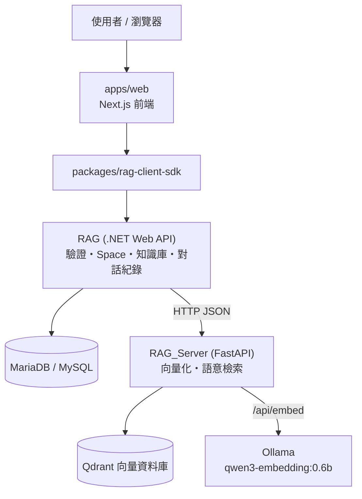

<div align="center">

# RAG 應用平台

**以語意檢索驅動的團隊知識問答平台**

*.NET Web API + Python 向量服務 + Next.js 前端，每個使用者擁有獨立的知識庫 Space*


</div>

---

## 📖 簡介

在後台維護問答知識庫（問題分類 / 問題項目 / 問答內容），系統會把問題轉成向量寫入 **Qdrant**；前台提問時以語意相似度找出最相關的內容並回覆，同時保留完整的對話歷史。

每位使用者註冊後都有自己的個人 **Space**，知識庫與對話只存在自己的 Space，不會互相污染。回答以 Markdown 輸出，程式碼區塊、清單、表格都能像 ChatGPT 一樣正確顯示。

## ✨ 功能特色

- 🔍 **語意檢索** — 以向量相似度找答案，不必比對關鍵字；高相似度直接回答，否則彙整多筆內容摘要
- 🗂️ **知識庫管理** — 問題分類、分類項目、問答內容與狀態（Verified / Stale / Inferred / Superseded）
- 🏠 **Space 隔離** — 個人 Space 與共用 Space，角色分 owner / member / viewer，授權一律由伺服器判斷
- 💬 **串流聊天室** — SSE 串流輸出、Markdown 渲染、程式碼高亮與複製、輸出時仍可往上捲動
- ✉️ **自行註冊** — 信箱 + Gmail 驗證信，點連結後才建立帳號；密碼以 PBKDF2-SHA512 儲存
- 📱 **PWA** — 可安裝到桌面 / 手機，離線時顯示提示頁
- 🔎 **SEO / GEO** — 使用者角度的 `/about` 介紹頁、sitemap、robots 與 `llms.txt`
- 🧩 **共用 SDK** — `@rag/client-sdk` 封裝 API、Token 更新與串流解析

## 🏗️ 系統架構



**運作流程**

1. 在 `.NET API` 建立問答資料，呼叫 `RAG_Server` 的 `/questionsToVector` 轉成向量寫入 Qdrant。
2. 使用者提問，`.NET API` 呼叫 `/ask`，`RAG_Server` 以語意相似度檢索。
3. 相似度超過門檻時直接回傳最相符的答案（`direct_match`）；否則彙整前幾筆內容做摘要（`context_summary`）。
4. `.NET API` 把問答結果寫入 `ChatHeader` / `ChatLog` 保存對話歷史。

## 🧰 技術棧

| 類別 | 技術 |
| --- | --- |
| 後端 API | .NET 10、ASP.NET Core Web API、Swagger |
| ORM | Entity Framework Core、Pomelo MySQL Provider、AutoMapper |
| 驗證 | JWT（Access / Refresh Token）、PBKDF2-SHA512 |
| 向量服務 | Python 3.11、FastAPI、Uvicorn、Pydantic v2 |
| 向量資料庫 | Qdrant（1024 維、Cosine 距離） |
| Embedding | 遠端 Ollama `qwen3-embedding:0.6b`（`/api/embed`）；服務本身不載入本地模型 |
| 前端 | Next.js 15、React 19、Tailwind CSS 4、react-markdown |
| 容器化 | Docker、Docker Compose、Nginx 反向代理 |

## 📂 專案結構

```text
RAG/                        .NET Web API
  ├ RAG/                    Controllers・Services・Repositories・Models・Registration
  ├ RAG.SpaceRuntime/       Space 授權
  ├ RAG.SkillRuntime/       Skill 執行
  ├ RAG.ToolRuntime/        Tool 執行
  └ RAG.Tests/              單元 / 整合測試
RAG_Server/                 Python FastAPI 向量服務（main.py、tests/）
apps/web/                   Next.js 前端（使用 packages/rag-client-sdk）
packages/rag-client-sdk/    共用 TypeScript client SDK
```

後端分層採 `Controller → Service → Repository`，以 `Param → Dto → Entity → Dto → ViewModel` 的映射流程隔離各層模型。

## ⚙️ 環境需求

- .NET SDK 10
- Python 3.11 以上
- Node.js 20 以上（前端）
- MySQL 8.0 / MariaDB
- Qdrant（可用 Docker 啟動）
- 可連線的 Ollama，並已安裝 `qwen3-embedding:0.6b`
- Docker / Docker Compose（若採容器部署）

> **注意**：`RAG.csproj` 參考了內部共用套件 `Library`（JWT、HTTP 例外、Swagger、Mail 等擴充），託管於私有來源，非公開發佈。沒有存取權時需自行提供對應實作或移除相關參考。

---

## 🚀 快速開始

### 1. RAG_Server（向量服務）

```bash
cd RAG_Server

python -m venv .venv
source .venv/bin/activate        # Windows: .venv\Scripts\activate
pip install -r requirements.txt

cp .env.example .env             # 依實際環境修改

# 啟動 Qdrant（若尚未啟動）
docker run -d -p 6333:6333 --name qdrant qdrant/qdrant

uvicorn main:app --host 0.0.0.0 --port 8007
```

Embedding 由遠端 Ollama 提供（`OLLAMA_BASE_URL`），啟動時不載入任何模型。`GET /model_status` 回 `status: ok` 表示 Ollama 可連線且已安裝指定模型；Ollama 失敗時寫入與查詢回 503，不做 fallback。

### 2. RAG（.NET API）

```bash
cd RAG

cp RAG/appsettings.Development.example.json RAG/appsettings.Development.json
#   → 填入 MySQL 連線字串與 RagOption:BaseUrl

cp RAG/encryption_config.example.json RAG/encryption_config.json
#   → 產生金鑰：openssl rand -base64 32

dotnet restore
dotnet run --project RAG/RAG.csproj
```

預設位址 `http://localhost:5115`，Swagger 在 `http://localhost:5115/swagger`。

### 3. apps/web（前端）

```bash
cd packages/rag-client-sdk && npm install && npm run build
cd ../../apps/web && npm install
npm run dev                      # http://localhost:3000
```

`NEXT_PUBLIC_RAG_API_URL` 指向 API 位址；留空時前端使用同源（搭配 Nginx 反向代理）。

---

## ✉️ 自行註冊與 Gmail 驗證信

預設**關閉**。開啟後任何人都能以信箱註冊：

1. `POST /api/v1/Auth/Register` 收到信箱與密碼，寄出驗證信（不論信箱是否已註冊，回應都相同，避免被用來探測帳號）。
2. 使用者點信中連結，前端 `/verify-email?token=…` 呼叫 `POST /api/v1/Auth/VerifyEmail`。
3. **此時才建立帳號**，並建立專屬的個人 Space（`u-<使用者編號>`，角色 owner、預設）。

註冊資料（含密碼雜湊）以 AES-GCM 加密放在驗證連結內，連結 24 小時有效；點擊之前資料庫裡不存在該帳號，不會有人搶先用別人的信箱佔住帳號。既有的明文密碼會在下次登入成功時自動升級為 PBKDF2。`POST /api/v1/User` 仍需登入，不是公開端點。

| 變數 | 說明 |
| --- | --- |
| `REGISTRATION_ENABLED` | `true` 才開放，預設 `false`；啟用時缺少下列任何設定，API 會直接啟動失敗 |
| `REGISTRATION_VERIFY_URL_BASE` | 前端驗證頁的完整網址，例如 `https://<前端網域>/verify-email` |
| `MAIL_HOST` / `MAIL_PORT` / `MAIL_USE_SSL` | Gmail：`smtp.gmail.com` / `587` / `true` |
| `MAIL_ACCOUNT` / `MAIL_PASSWORD` | Gmail 帳號與**應用程式密碼**（需先開兩步驟驗證，不是登入密碼） |

應用程式密碼只放在伺服器的 `.env` / 環境變數，**不要**寫進程式碼、設定檔範本或對話。

**上線順序**：① 備份後執行 `RAG/RAG/Migrations/Scripts/20261107-email-registration-columns.sql`（放寬 `Account`、`Password` 長度）→ ② 部署新版 API → ③ 設定上述變數並開啟 `REGISTRATION_ENABLED`。順序反了，新版寫入長值時舊欄位會被資料庫拒絕。

**防濫用**：註冊端點全域每分鐘 30 次、驗證端點每個來源 IP 每分鐘 60 次、同一信箱 60 秒內只寄一次。尚未做圖形驗證（例如 Cloudflare Turnstile）與每位使用者的用量上限，開放給陌生人之前建議補上。

---

## 🐳 Docker 部署

```bash
cd RAG
cp .env.example .env        # 填入 DB_CONNECTION_STRING、RAG_SERVER_BASE_URL 等
docker compose up -d --build
```

`RAG_Server` 亦可獨立建置：

```bash
cd RAG_Server
docker build -t rag-server .
docker run -d -p 8007:8007 -e QDRANT_HOST=<qdrant-host> -e QDRANT_PORT=6333 --name rag-server rag-server
```

| 服務 | 容器內 Port | 說明 |
| --- | --- | --- |
| rag-web (Next.js) | 8005 | 前端 |
| rag-api (.NET) | 8006 | 主要 API |
| rag-ai (FastAPI) | 8007 | 向量化與檢索 |
| Qdrant | 6333 | 向量資料庫 |

建議以 Nginx 同網域反向代理：`/` → 前端、`/api/` → API、`/ai/` → 向量服務。聊天串流路徑需關閉 `proxy_buffering`。

## 🔧 設定說明

所有機敏資訊皆透過**環境變數**或**未納入版控的設定檔**提供，儲存庫只保留 `*.example` 範本。

### RAG（.NET API）

| 設定鍵 | 環境變數 | 說明 |
| --- | --- | --- |
| `ConnectionStrings:DefaultConnection` | `ConnectionStrings__DefaultConnection` | MySQL 連線字串 |
| `RagOption:BaseUrl` | `RagOption__BaseUrl` | RAG_Server 服務基底位址 |
| `RagOption:AskUrl` 等 | `RagOption__AskUrl` | 各端點路徑，預設值可直接使用 |

`encryption_config.json` 內的 `JWT_SECRET_KEY` 是 JWT 簽章金鑰，**務必**自行產生且不得納入版控。

### RAG_Server（FastAPI）

| 環境變數 | 預設值 | 說明 |
| --- | --- | --- |
| `QDRANT_HOST` / `QDRANT_PORT` | `localhost` / `6333` | Qdrant 位址 |
| `QDRANT_COLLECTION` | `rag_knowledge_v2` | Collection 名稱（更換 embedding 模型必須使用新 collection） |
| `OLLAMA_BASE_URL` | `http://192.168.0.188:11434` | Ollama 位址 |
| `OLLAMA_EMBED_MODEL` | `qwen3-embedding:0.6b` | Embedding 模型 |
| `EMBEDDING_DIMENSION` | `1024` | 向量維度（與回傳不符時拒絕寫入 / 查詢） |
| `DIRECT_MATCH_THRESHOLD` / `DIRECT_MATCH_MARGIN` / `SIMILAR_SCORE_THRESHOLD` | `0.70` / `0.05` / `0.50` | `/ask` 判斷門檻；與 .NET ContextRuntime 共用同一組值 |
| `SUMMARY_MAX_CHARS` | `500` | 摘要回覆的最大字數（只在段落 / 程式碼區塊邊界截斷） |
| `CORS_ORIGINS` | `*` | 允許來源，多筆以逗號分隔 |

## 🔌 API 一覽

### RAG（.NET API，路徑前綴 `/api/v1`）

| 方法 | 路徑 | 說明 |
| --- | --- | --- |
| `POST` | `/Auth/Login` | 登入並取得 Access / Refresh Token |
| `POST` | `/Auth/Register`、`/Auth/VerifyEmail` | 自行註冊與驗證信箱 |
| `GET` | `/Space` | 目前使用者可存取的 Space |
| `GET` `POST` `PUT` `DELETE` | `/User` | 使用者管理 |
| `GET` `POST` `PUT` `DELETE` | `/QaType`、`/QaTypeItem` | 問答分類與分類項目 |
| `GET` `POST` `PUT` `DELETE` | `/Question` | 問答內容（新增 / 更新 / 刪除會同步向量） |
| `POST` | `/Chat`、`/Chat/ChatStream` | 提問（一般 / SSE 串流） |
| `GET` `DELETE` | `/Chat`、`/Chat/{chatId}` | 對話清單、訊息紀錄與刪除 |

完整規格請參考執行後的 Swagger 頁面。

### RAG_Server（FastAPI）

| 方法 | 路徑 | 說明 |
| --- | --- | --- |
| `GET` | `/`、`/model_status` | 服務與 Ollama embedding 狀態 |
| `POST` | `/questionsToVector` | 批次將問題轉向量並寫入 Qdrant |
| `POST` | `/ask` | 語意檢索並產生回答 |
| `GET` | `/questions` | 列出已建立的問題（預設上限 100 筆） |
| `DELETE` | `/questions/{question_id}`、`/delete_type/{type_value}` | 刪除指定問題 / 分類的向量 |
| `GET` | `/collections` | 列出所有 Collection |

### Postman 匯入

`RAG_Server/docs/` 內有可直接匯入的檔案（由 `python RAG_Server/scripts/export_openapi.py` 產生，不含金鑰）：

| 檔案 | 用途 |
| --- | --- |
| `rag-ai.postman_collection.json` | Postman Collection：每個端點都有範例，變數 `baseUrl`（預設 NAS 的 `/ai`）與 `internalApiKey` |
| `rag-ai.openapi.json` | OpenAPI 3.1，可匯入 Postman / Swagger Editor 等工具 |

匯入 Collection 後，在 **Variables** 填入 `internalApiKey`（對應伺服器的 `INTERNAL_API_KEY`），受保護的端點以 `X-Internal-Api-Key` 標頭驗證。

## 🛠️ 開發與測試

```bash
# .NET（需設定 Library 位置）
dotnet test RAG.Tests

# Python 向量服務
cd RAG_Server && pytest

# 前端與 SDK
cd packages/rag-client-sdk && npm test
cd apps/web && npm run build
```

## 🔒 安全性注意事項

- `appsettings.Development.json`、`.env`、`encryption_config.json` 已列入 `.gitignore`，**請勿**提交至版控。
- 正式環境請把 `CORS_ORIGINS` 由 `*` 改為明確的網域清單。
- `RAG_Server` 未內建驗證機制，請勿直接對外開放，建議只允許 `.NET API` 由內網存取。
- 授權一律由後端依 Space 與角色判斷，前端的隱藏與停用只是體驗，不是安全邊界。
- JWT 金鑰請定期輪替，並使用足夠長度的隨機字串。
