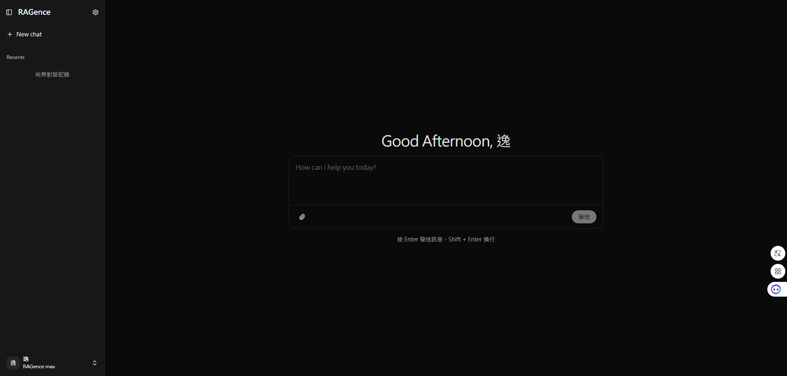

<p align="center">
  <br/>
  <h1>RAGence</h1>
  <p>一個基於 <b>RAG（Retrieval-Augmented Generation）</b> 技術的 AI 對話平台<br/>提供流暢的串流式對話體驗、多角色權限管理，以及完整的主題客製化系統。</p>
</p>

<p align="center">
  
</p>

---

## 技術棧

| 類別 | 技術 |
|------|------|
| 框架 | Next.js 15.5.4 + React 19 + TypeScript |
| 樣式 | Tailwind CSS 4 + OKLCH 色彩系統 |
| UI 元件 | Radix UI + Shadcn UI |
| API | `@rag/client-sdk`（`/api/v1/*`，401 自動 refresh） |
| 建置工具 | Turbopack |

---

## 功能特色

### AI 對話
- **串流式回應** — 使用 SSE 即時顯示 AI 生成內容，支援中途中止
- **多對話管理** — 自動建立、命名、切換、刪除對話紀錄
- **動態問候語** — 依早 / 午 / 晚自動調整歡迎訊息
- **QA 類型選擇** — 依不同主題分類引導 AI 回答方向

### 使用者系統
- **登入 / 註冊** — 帳號密碼認證，預留 Google OAuth 介面
- **多語言名稱** — 自動偵測中文 / 英文 / 其他語言並分類儲存
- **個人資料管理** — 修改顯示名稱與密碼
- **角色權限控制** — `user` / `pro` / `max` 三級權限，Pro 以上才能使用管理功能

### 管理員功能（Pro/Max）
- **Q&A 知識庫管理** — 新增、編輯、刪除問答對
- **分類細項管理** — 依 QA 類型和子類型分類知識庫
- **聊天歷史查看** — 瀏覽所有使用者對話紀錄

### 主題系統
- **深色 / 淺色模式**切換
- **10 種主題色** — Gray、Blue、Purple、Pink、Red、Orange、Yellow、Green、Teal
- 使用 OKLCH 色彩空間，色彩更接近人眼感知

---

## 專案結構

```
src/
├── app/
│   ├── (auth)/
│   │   ├── login/           # 登入頁面
│   │   └── signup/          # 註冊頁面
│   └── (main)/
│       ├── page.tsx          # 主對話頁面
│       ├── profile/          # 個人資料
│       └── admin-settings/   # 管理員設定
│           └── history/      # 聊天歷史紀錄
├── components/
│   ├── ui/                   # 基礎 UI 元件（Button, Dialog, Select...）
│   ├── app-sidebar.tsx       # 使用者側邊欄
│   ├── admin-sidebar.tsx     # 管理員側邊欄
│   └── theme-color-picker.tsx
├── contexts/
│   └── theme-context.tsx     # 全域主題狀態管理
└── lib/
    └── theme-colors.ts       # 主題色彩定義
```

---

## 快速開始

```bash
cd apps/web
cp .env.example .env     # 填入 NEXT_PUBLIC_RAG_API_URL（.NET API 位址，不含 /api/v1）
npm install
npm run dev              # 會先建置 packages/rag-client-sdk（predev）
```

`npm run build && npm start` 建置生產版本。`npm run typecheck` / `npm run lint` 檢查。

---

## 與後端的對應

| 畫面 | SDK |
|------|-----|
| 登入 | `auth.login`，之後 `spaces.list/select` 選定預設 Space |
| 對話 | `chat.stream`（SSE，先收到 `chat` 事件取得聊天室編號）、`chat.history/logs/delete` |
| 檢索範圍 | `qaTypes.list` → 傳給 `chat.stream` 的 `type` |
| 知識庫管理（pro/max） | `qaTypes` / `qaTypeItems` / `questions`（含知識狀態 Verified/Stale/Inferred/Superseded） |
| 個人資料 | `users.get/update`（後端只允許本人） |
| 側邊欄 Space 切換 | `spaces.list/select`，切換後清空快取並重新載入 |

- **範圍由伺服器決定**：不再傳 `UserID`；Space 只是 hint，授權一律以伺服器為準。
- **Token**：只放記憶體與 `sessionStorage`（分頁關閉即清除），不使用 `localStorage`。
  sessionStorage 仍可被頁面內 XSS 讀取；要更嚴格需改為 httpOnly cookie 的 BFF。
- **註冊**：帳號就是信箱。`/signup` → 伺服器寄驗證信 → 使用者點信中連結（`/verify-email?token=…`）→ 才建立帳號並取得自己的個人 Space。後端預設不開放註冊（見根目錄 README「自行註冊與 Gmail 驗證信」）。
- **管理入口**：依目前 Space 的 `knowledge.write` 權限顯示（自行註冊的使用者是自己 Space 的 owner），不再看全域的 `manage` 層級。
- 後端需允許此網站來源的 CORS。

---

## PWA

可安裝到桌面 / 主畫面（`manifest.ts` + 圖示），並有基本的 Service Worker（`public/sw.js`），只在正式環境註冊（`npm run build && npm start`）。

- **只快取靜態外殼**：`/_next/static/`（檔名含雜湊）與圖示；離線時顯示 `public/offline.html`。
- **刻意不快取**：跨來源請求（.NET API）、`/api/`、非 GET、SSE 串流、頁面 HTML。這是問答系統，快取會讓使用者看到舊答案或別人的資料。
- 問答需要連線，所以「離線」只會顯示提示頁，不是離線問答。
- 修改 `sw.js` 時請調高裡面的 `VERSION`，舊快取會在 activate 時清除。
- 需要 HTTPS 才能安裝（`localhost` 例外）。
- 動態 logo：`public/logo-animated.gif`（貓咪呼吸、眨眼、星星閃爍，約 200 KB）。`<Logo animated />` 使用，並在「減少動態效果」設定下改顯示靜態版；首屏的大張斜放主視覺用 `public/logo-animated-large.gif`（480px，約 370 KB）。兩者都用 `scripts/logo/make-logo-gif.js` 產生（腳本開頭有指令）。
- GIF 是白底、靠 `mix-blend-multiply` 融入背景，所以**旋轉、漂浮等 transform 必須掛在圖片本身**，掛在祖先元素會形成獨立堆疊情境、白底就會露出來。
- 畫面中的 logo 是 `public/logo-mark.png`（透明背景，深色模式自動反相），由 `<Logo />` 元件使用；App 圖示需要不透明，所以仍是白底。
- 圖示（`public/icons/`、`src/app/icon.png`、`apple-icon.png`、`public/logo.jpg`）皆由同一張貓咪 logo 產生；maskable 版本四周留有安全邊距。

---

## GEO / SEO

這是需要登入的 App，所以策略是「**只開放一個公開頁，其餘一律不收錄**」。

| 項目 | 做法 |
|------|------|
| 公開頁 | `/about`：以使用者角度說明產品能做什麼（好處 + 實際畫面 + 常見問題），內容與結構化資料共用 `src/app/about/content.ts` |
| 結構化資料 | `/about` 內嵌 JSON-LD：WebSite、SoftwareApplication、FAQPage（只放可驗證的事實，不含價格、評分、公司資訊） |
| 預設不收錄 | 根 layout `robots: noindex`；只有 `/about` 設為 `index`。`/profile`、`/admin-settings`、`/verify-email`（網址帶有 token）另在 robots.txt 禁止 |
| robots.txt | 允許 AI 搜尋型爬蟲（GPTBot、OAI-SearchBot、ChatGPT-User、ClaudeBot、PerplexityBot、Google-Extended…）讀取 `/about`；禁止 AI 訓練型（CCBot、anthropic-ai、Bytespider、cohere-ai）整站 |
| sitemap / llms.txt | `/sitemap.xml` 只列 `/about`；`/llms.txt` 提供站台摘要與重點事實 |
| 分享圖 | `opengraph-image.png`、`twitter-image.png`（1200×630） |

官網畫面（`public/screenshots/`）是用範例資料拍的產品實際畫面，更新方式見 `scripts/screenshots/shoot.js` 開頭說明。

**正式環境必須設定 `NEXT_PUBLIC_SITE_URL`**（例如 `https://rag.example.com`）：canonical、sitemap、llms.txt、JSON-LD 的 `@id` 都需要絕對網址；沒設定時 sitemap 為空、JSON-LD 不含 `@id`。

限制：首頁 `/` 是 App 本體（需登入），爬蟲看到的是載入畫面，所以把介紹頁放在 `/about`，並由 llms.txt、sitemap 指向它。
尚未做（需要你提供真實資料）：Organization 結構化資料與 `sameAs`（官方 LinkedIn、GitHub、YouTube 等連結）、Google Search Console / Bing Webmaster 驗證。

---

## 環境變數

```env
NEXT_PUBLIC_RAG_API_URL=http://localhost:5115
```
